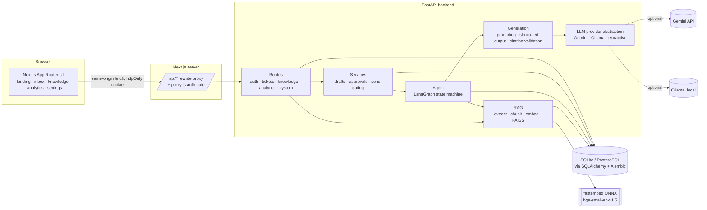
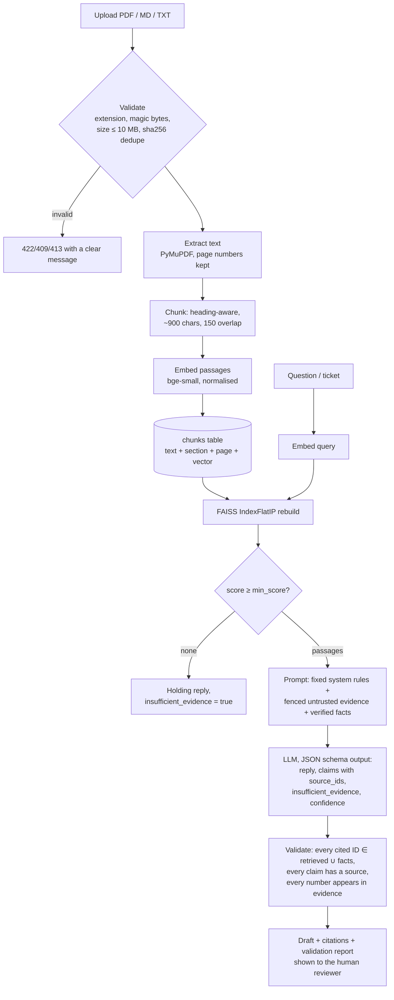
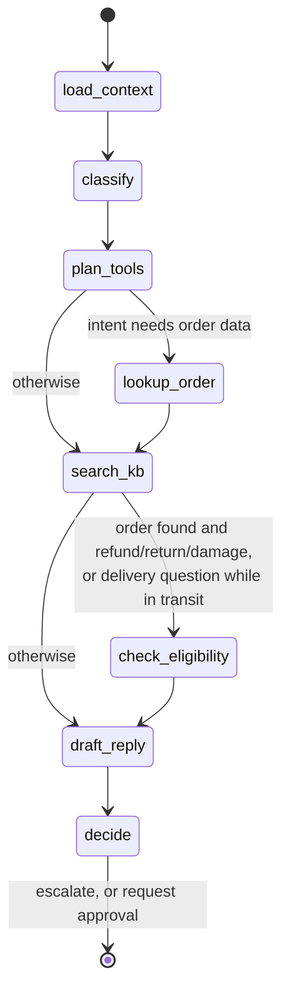
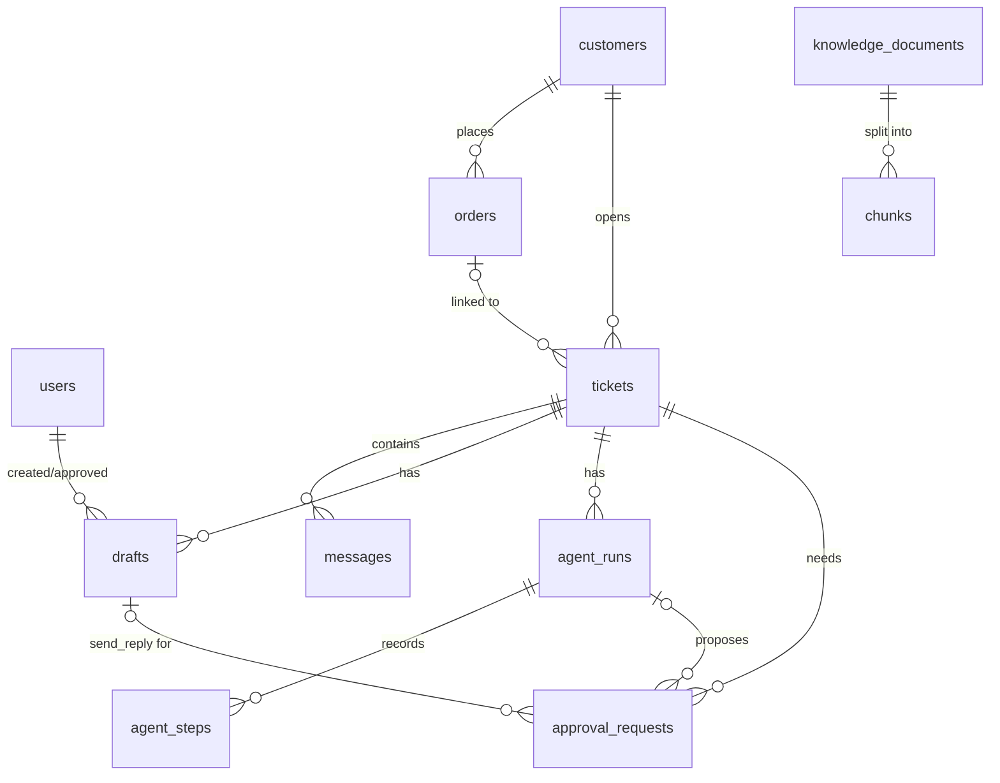

# SupportIQ architecture

## System overview

The browser only talks to the Next.js origin. `/api/*` is rewritten to FastAPI on the server, so the session cookie is first-party and no backend URL or credential reaches client code. FAISS is an in-memory accelerator rebuilt from embeddings stored in the `chunks` table, so the index can't drift from the database.

## GenAI pipeline

## Agent state machine

| Node | Tool | Typed input → output | Notes |
|---|---|---|---|
| load_context | `get_ticket_context` | ticket id → messages, customer, linked order id | |
| classify | `classify_ticket` | subject + message → `TicketClassification` | LLM + deterministic flags; model-extracted order IDs discarded unless found verbatim by regex |
| plan_tools | — | classification → tool list + rationale | deterministic policy, recorded |
| lookup_order | `lookup_order` | `OrderLookupInput{order_id ^HC-\d{5}$, customer_id}` → `OrderLookupOutput` | refuses orders belonging to other customers |
| search_kb | `search_knowledge_base` | `KBSearchInput{query, k≤10}` → `KBSearchOutput` | threshold-filtered |
| check_eligibility | `check_eligibility` | `EligibilityInput{order, intent, as_of}` → `Eligibility` | pure rules RR-0…RR-8 |
| draft_reply | `generate_grounded_reply` | evidence + facts + tone → draft + validation | falls back to extractive if the model fails |
| decide | `request_approval` | state → decision + `ApprovalRequest` rows | never sends, never refunds |

Bounds: fixed graph (no loops), `recursion_limit=20`, 120 s run budget checked before every node, LLM calls with HTTP timeouts and at most `LLM_MAX_RETRIES` retries with backoff, every node wrapped so an exception becomes an `error` step plus escalation instead of a crash.

Escalation triggers: sensitive flags (legal threat, chargeback, safety, privacy, harassment, prompt injection), insufficient evidence, failed citation/number validation, lost-package investigation, or a request outside policy. Escalated runs create only a `send_reply` approval that requires the **lead** role; refund approvals are proposed only for in-policy cases, and require a lead above $300.

## Database schema

Key columns: `messages.delivery` (`simulated` for approved replies: there is no email integration), `drafts.original_body` vs `body` (measures human edits), `drafts.validation` (JSON report), `chunks.embedding` (float32 bytes), `approval_requests.required_role`, `tickets.is_synthetic` / `customers.is_synthetic`.

## Security controls

- **Auth:** PBKDF2-SHA256 (240k iterations) password hashes; HS256 JWT in an `httpOnly`, `SameSite=Lax` cookie (`Secure` via `COOKIE_SECURE`); `JWT_SECRET` mandatory in production.
- **Authorization:** roles `agent` < `lead`, enforced server-side for deleting/re-indexing documents, resolving escalated tickets, approving escalated replies and refunds above the threshold.
- **Prompt-injection defence:** fixed system prompt; customer text and documents wrapped in delimiters with our own tags neutralised; schema-constrained output; injection heuristics flag and escalate; the model has no tools that act externally.
- **Hallucination controls:** relevance threshold, citation-ID validation, unsupported-claim and unverified-number detection, insufficient-evidence abstention.
- **Abuse protection:** per-user AI rate limit, per-IP login rate limit, upload size cap read without buffering beyond the limit, magic-byte checks, request-body validation via Pydantic.
- **Logging:** method, path, status and duration only; no bodies, cookies, query strings or keys.
- **Secrets:** only in backend environment; `/api/system/status` reports presence, never values.
